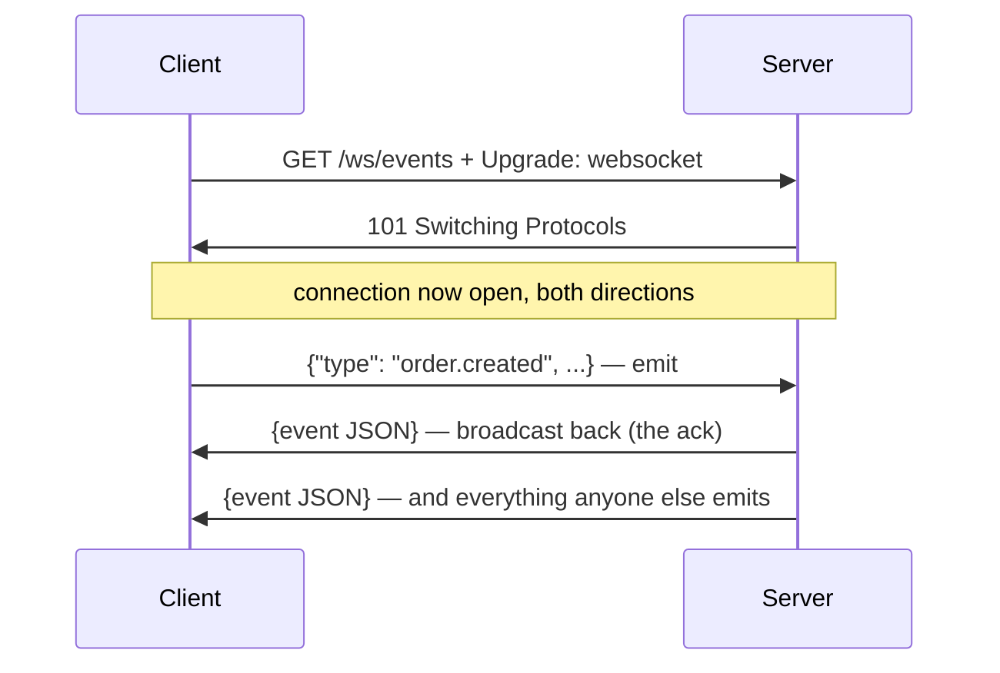
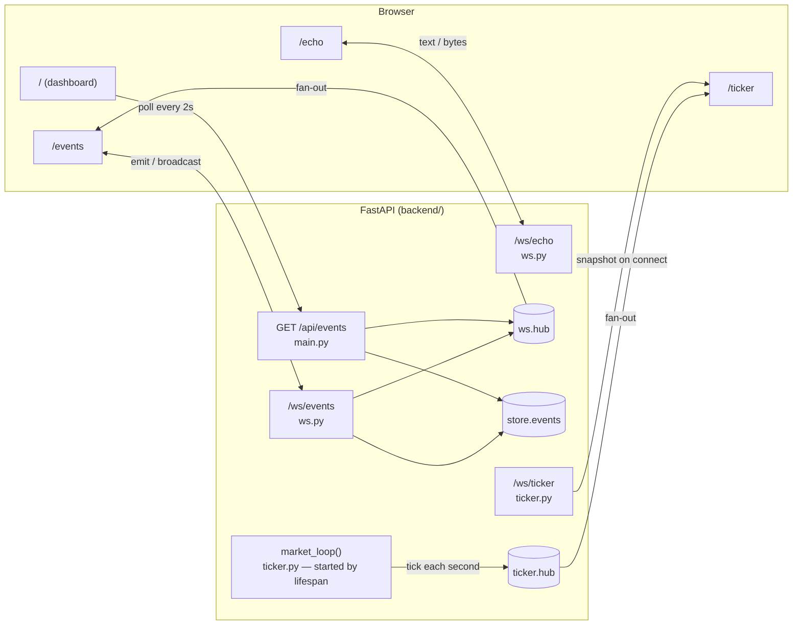

# websockets-101

A hands-on guide to **WebSockets**, built around a working playground you
can run locally. The toy flow — *something happened, tell the interested
parties* — over the simplest possible transport: one open socket per
subscriber.

## What is a WebSocket?

A WebSocket starts life as an ordinary HTTP request with an
`Upgrade: websocket` header. The server agrees (`101 Switching
Protocols`), and the TCP connection stops being request/response and
becomes a **bidirectional pipe**: either side can send a message at any
time, with no headers and almost no overhead per frame.



That is the entire trick. Everything else — pings, reconnection,
backpressure — is plumbing on top.

**`ws://` vs `wss://`** is the same split as `http`/`https`: `wss` does
the TLS handshake first, then the upgrade happens inside the encrypted
tunnel. Browsers require `wss` from `https` pages, and proxies can't
mangle traffic they can't read — so production is always `wss`. This
demo uses `ws` because localhost needs no certificate.

## How the playground is built

One FastAPI process, no database, no broker. Each socket family has its
own `Hub` — a set of open connections with a `broadcast()` that writes
to each one.



Three shapes, from simplest to most realistic:

| Socket | Direction | Shape |
| --- | --- | --- |
| `/ws/echo` | request → reply, same socket | the raw loop — no hub at all |
| `/ws/events` | both ways, fan-out | chat / pub-sub — any client can emit |
| `/ws/ticker` | server → client only | market data — snapshot, then a stream of deltas |

## Why it needs less machinery than a webhook

A webhook's per-delivery machinery — signatures, delivery IDs, retry
log — exists because *each event arrives as an anonymous HTTP request*.
On a socket the connection itself is the identity: it's still open, or
it isn't. The subscriber dials out and holds the line — no public URL,
no signature, no retry log.

The flip side: a socket that's down at broadcast time gets nothing. If an
event *must* arrive, that's a webhook's job (or a durable queue behind
either mechanism).

## Run it

```bash
uv sync
uv run uvicorn backend.main:app --reload --port 8100
```

Open <http://localhost:8100> — the dashboard links to an interactive
page per socket (`/echo`, `/events`, `/ticker`). Tests: `uv run pytest`.

Serve this documentation locally:

```bash
uv run mkdocs serve   # http://127.0.0.1:8000
```

## Where to go next

1. [WebSockets](websockets.md) — the handshake, the hub, message
   contracts, and how this repo's endpoints work.
2. [DevTools](devtools.md) — watch the handshake and every frame in Chrome.
3. [Exercises](exercises.md) — reconnection, slow clients, auth at the
   handshake, rooms.
4. [Quiz](quiz.md) — self-check.

## The sibling playgrounds

This repo is one of three:

- **`../webhooks`** — the same flow over signed HTTP `POST`s with
  retries: what you use when the two sides are strangers on the internet.
- **`../grpc-101`** — the same flow as typed RPC streams with a `.proto`
  contract: what you use service-to-service.
