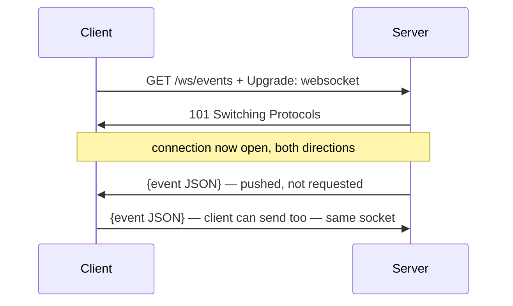

# WebSockets

The playground is three sockets in two modules: `backend/ws.py` holds the
`Hub`, the echo socket and the live event feed (connecting subscribes
you *and* sending on the socket emits an event); `backend/ticker.py` holds a
pure-push market feed driven by a background task that `backend/main.py`'s
lifespan starts.

## What a WebSocket is

A WebSocket starts life as an ordinary HTTP request with an
`Upgrade: websocket` header. The server agrees (`101 Switching
Protocols`), and the TCP connection stops being request/response and
becomes a **bidirectional pipe**: either side can send a message at any
time, with no headers and almost no overhead per frame.



That is the entire trick. Everything else — pings, reconnection,
backpressure — is plumbing on top.

## `ws://` vs `wss://`

Same relationship as `http://` vs `https://`:

| | `ws://` | `wss://` |
| --- | --- | --- |
| Transport | plain TCP | TCP + TLS |
| Default port | 80 | 443 |
| The upgrade | sent in cleartext | happens *inside* the TLS tunnel |

The handshake and every frame after it are byte-for-byte identical —
`wss` just does the TLS handshake first, then upgrades. So `wss` is what
you use anywhere real:

- **Browsers enforce it.** A page loaded over `https` may only open
  `wss://` sockets — `ws://` is blocked as mixed content. This is why
  every page in `ui/` builds its URL as
  `location.origin.replace("http", "ws")`: `http:` → `ws:` and `https:`
  → `wss:` fall out of the same line.
- **Middleboxes tolerate it.** Plenty of proxies strip `Upgrade`
  headers or buffer frames on plaintext `ws` connections; they can't
  touch traffic they can't read, so `wss` survives them.

This playground runs `ws://` because it's localhost — no certificate to
fuss with, and nothing between you and the server.

## WebSocket vs webhook

| | Webhook | WebSocket |
| --- | --- | --- |
| New event = | a brand-new HTTP POST | a frame on an already-open socket |
| Subscriber must be | a public server | just a client that stays connected |
| Auth | signature on every delivery | decided once, at the handshake |
| Failure model | retries, backoff, dead-letter | socket closes; client reconnects |
| Overhead per event | headers + signature + new connection | ~2 bytes of framing |

The webhook's per-delivery machinery — signatures, delivery IDs, retry
log — exists because *each event arrives as an anonymous HTTP request*.
On a socket the connection itself is the identity: it's still open, or
it isn't.

## The endpoints here

| Endpoint | Code | Behavior | What it teaches |
| --- | --- | --- | --- |
| `WS /ws/echo` | `ws.echo` | text → `echo: <text>`; binary → same bytes back | the raw send/receive loop |
| `WS /ws/events` | `ws.events` | joins `ws.hub`; every event sent on any socket broadcasts to all | the subscription pattern, in both directions |
| `WS /ws/ticker` | `ticker.ticker` | joins `ticker.hub`; snapshot on connect, then a tick every second from `market_loop` | a one-directional feed — the market-data shape most real websockets have |
| `GET /api/events` | `main.api_events` | last 30 events, newest first, plus `len(ws.hub.connections)` | catching up over plain HTTP — what the dashboard polls |

The pages (`/`, `/echo`, `/events`, `/ticker`) are static files in `ui/`,
served through `backend/ui.py`'s `page()`.

### The hub

`backend/ws.py`'s `Hub` keeps a *set of open sockets* and `send_text`s to
each — fan-out over connections instead of fan-out over callback URLs.
A send that raises means the socket died since it connected, so it's
pruned after the loop:

```python
async def broadcast(self, message: dict) -> int:
    dead = []
    for ws in self.connections:
        try:
            await ws.send_text(json.dumps(message))   # vs. client.post(url, ...)
        except Exception:  # socket died between connect and send
            dead.append(ws)
    for ws in dead:
        self.disconnect(ws)
    return len(self.connections)
```

`ticker.py` reuses the same class with its own instance (`ticker.hub`),
so ticks never reach `/ws/events` subscribers and the dashboard's client
count covers `/ws/events` only.

### Message contracts

**`/ws/events`** — send anything; it always becomes an event envelope:

| You send | Broadcast `type` | Broadcast `data` |
| --- | --- | --- |
| `{"type": "order.created", "data": {"order_id": 42}}` | `order.created` | `{"order_id": 42}` |
| `{"data": {...}}` (no `type`) | `demo.ping` | as sent |
| `{"type": "x"}` (no `data`) | `x` | `{}` |
| `hello all` (not JSON) | `message` | `{"text": "hello all"}` |

```json
{"id": "evt_3f9c1a2b7d4e", "type": "order.created",
 "created_at": "2026-11-13T10:15:02+00:00", "data": {"order_id": 42}}
```

The server adds `id` and `created_at`, appends to `store.events`, and
broadcasts to every connection — including the sender's, which doubles
as the acknowledgement.

**`/ws/ticker`** — receive only; what you send is ignored. Both message
types carry the full board in the same quote shape:

```json
{"type": "snapshot", "data": [{"symbol": "ACME", "price": 182.5, "change": 0, "dir": "flat"}, ...]}
{"type": "tick",     "data": [{"symbol": "ACME", "price": 183.1, "change": 0.6, "dir": "up"}, ...]}
```

The snapshot comes once, right after the handshake (every `change` is 0,
every `dir` is `flat`); ticks follow each second. Prices are a Gaussian
random walk (σ = 0.4% per tick) floored at 0.01, held in
`ticker.prices` — process memory, so they reset on restart.

## Run it

```bash
uv run uvicorn backend.main:app --reload --port 8100
```

Open <http://localhost:8100> — the dashboard links to an interactive
page per socket: `/echo` to round-trip a message, `/events` to emit and
watch the broadcast land on every connected client, `/ticker` for a
pure-push feed.

Try it by hand too, with `websocat` or Python:

```python
import asyncio, websockets

async def go():
    async with websockets.connect("ws://localhost:8100/ws/events") as ws:
        await ws.send('{"type": "demo.ping", "data": {}}')   # emit
        print(await ws.recv())   # your own broadcast back
asyncio.run(go())
```

[DevTools](devtools.md) shows how to see the handshake and every frame
in Chrome.

## Things worth noticing

- **Disconnects are detected by reading.** The server only learns a
  client is gone when a read or write fails. That's why `/ws/ticker`
  keeps a receive loop even though it ignores everything clients send —
  without it a closed socket would linger in `ticker.hub` until the next
  failed send.
- **Uvicorn already sends pings.** Protocol-level ping frames go out
  every 20s and a client that doesn't pong within 20s is dropped
  (`--ws-ping-interval` / `--ws-ping-timeout`). None of that is visible
  to the app code — it just sees a disconnect.
- **No delivery guarantees.** A socket that's down at broadcast time
  gets nothing — no queue, no retry. If an event *must* arrive, that's a
  webhook's job (or a durable queue behind either mechanism).
- **Half the web stack isn't needed.** No signature header: the TLS +
  auth done at the HTTP upgrade covers the whole connection lifetime.
- **The broadcast is the ack.** Because the emitter sits on the same
  feed, it sees its own event come back — the cheapest possible
  confirmation that the server accepted it.

## Common WebSocket bugs

| Bug | Symptom |
| --- | --- |
| Only `send`ing, never `receive`ing | disconnects go unnoticed; hub keeps a ghost connection |
| No reconnection logic in the client | "works on my machine," dies on the first network blip |
| Broadcast writes one-by-one to a huge set | one slow client stalls everyone — real hubs send concurrently or use per-connection queues |
| Putting auth only *after* connect | socket opens unauthenticated — verify at the handshake |
| Assuming valid JSON is an object | `/ws/events` here: sending `42` or `[1]` raises `AttributeError` on `.get` and the server closes the socket — validate the shape, not just the syntax |
| Iterating the live connection set across an `await` | `Hub.broadcast` here: a client joining or leaving mid-broadcast can raise `RuntimeError: Set changed size during iteration` — iterate a copy (`list(self.connections)`) |
